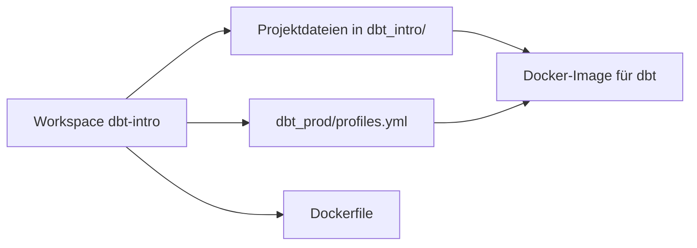
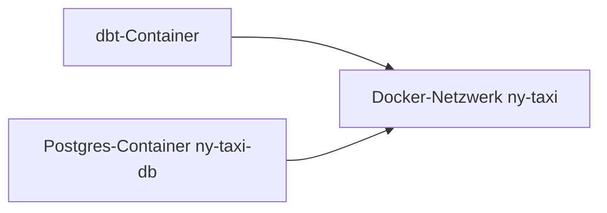

# dbt in Docker ausführen

Dieser Leitfaden ist der nächste Schritt nach [01-dbt-intro](./01-dbt-intro.md). Er setzt voraus, dass du schon Folgendes hast:

- ein funktionierendes Projekt `dbt_intro`,
- einen Postgres-Container namens `ny-taxi-db`,
- die Datenbank `ny_taxi`, befüllt mit den Quelldaten aus 01.

Das Ziel ist hier einfach: dieses funktionierende dbt-Projekt in ein Docker-Image verpacken und dbt in einem Container ausführen statt in deiner lokalen Python-Umgebung.

## Bevor du anfängst

Starte im fertigen Workspace aus 01. Anders gesagt: Führ diese Schritte nicht im Stammverzeichnis des Repositorys aus. Nutz den frischen Workspace `dbt-intro/`, den du in Kapitel 01 gebaut hast.

Docker muss laufen, bevor du anfängst, denn dieses Kapitel setzt voraus, dass sowohl der bestehende Container `ny-taxi-db` als auch die Build-Engine von Docker verfügbar sind.

## Was wir in Docker verpacken

Du solltest dich im **Stammverzeichnis des Workspace aus 01** befinden. Dein Ordner sollte ungefähr so aussehen:

```text
dbt-intro/
  ├── data/
  ├── dbt_intro/
  └── logs/
```

Wir fügen diesem Stammverzeichnis des Workspace noch ein paar Dinge hinzu:

- `dbt_prod/profiles.yml`
- `Dockerfile`



## Warum dbt in Docker ausführen?

dbt in Docker auszuführen ist nützlich, weil du damit Folgendes bekommst:

- eine reproduzierbare Laufzeitumgebung mit fester Python- und dbt-Version,
- einen saubereren Weg zu CI/CD oder zur Orchestrierung in Produktion,
- eine Möglichkeit, dbt auszuführen, ohne von einer lokal aktivierten virtuellen Umgebung abzuhängen.

## 1. Postgres und dbt ins selbe Docker-Netzwerk bringen

In 01 hast du dich von deinem Host-Rechner aus über Port `5432` mit Postgres verbunden. In Docker muss der dbt-Container Postgres **von Container zu Container** erreichen, deshalb müssen beide Container im selben Docker-Netzwerk sein.

Erstell das Netzwerk, falls es noch nicht existiert:

```bash
docker network create ny-taxi 2>/dev/null || true
```

Verbinde den bestehenden Postgres-Container aus 01:

```bash
docker network connect ny-taxi ny-taxi-db 2>/dev/null || true
```

Wenn der zweite Befehl meldet, dass der Container schon verbunden ist, ist das in Ordnung.

### Warum `POSTGRES_HOST` nicht `localhost` ist

Im dbt-Container bedeutet `localhost` „dieser dbt-Container“, nicht dein Datenbank-Container. Deshalb nutzen wir:

```text
POSTGRES_HOST=ny-taxi-db
```

`ny-taxi-db` ist der Name des Postgres-Containers, und das interne Netzwerk von Docker kann ihn automatisch auflösen.



## 2. Produktivprofil für den Container erstellen

Erstell im Stammverzeichnis des Workspace `dbt-intro` einen Ordner für das Produktivprofil:

```bash
mkdir -p dbt_prod
```

Erstell `dbt_prod/profiles.yml` mit diesem Inhalt:

```yaml
dbt_intro:
  outputs:
    prod:
      type: postgres
      threads: 4
      host: "{{ env_var('POSTGRES_HOST') }}"
      port: 5432
      user: "{{ env_var('POSTGRES_USER') }}"
      pass: "{{ env_var('POSTGRES_PASSWORD') }}"
      dbname: "{{ env_var('POSTGRES_DB') }}"
      schema: dbt_prod

  target: prod
```

Dieses Profil hält Zugangsdaten und Host-Informationen aus dem Image selbst heraus. Zur Laufzeit übergeben wir sie über Umgebungsvariablen.

### Erwartete Schemanamen in Produktion

Wenn du 01 durchgearbeitet hast und deine Modelle eigene Schemas wie `stg`, `int` und `driver` nutzen, liefert dir die standardmäßige Benennung der Schemas in dbt:

- `dbt_prod_stg`
- `dbt_prod_int`
- `dbt_prod_driver`

Das entspricht dem lokalen Muster `dbt_dev_*` aus 01.

Ein kleines Detail, mit dem du rechnen solltest:

- Seeds landen im Basis-Zielschema, etwa `dbt_prod`,
- Modelle, die eigene Schemas deklarieren, landen in Schemas mit Präfix, etwa `dbt_prod_stg`, `dbt_prod_int` und `dbt_prod_driver`.

## 3. `Dockerfile` erstellen

Bleib im Stammverzeichnis des Workspace `dbt-intro` und erstell dort ein `Dockerfile`:

```dockerfile
FROM ghcr.io/astral-sh/uv:0.13.5 AS uv
FROM python:3.13.17-slim-bookworm

RUN apt-get update \
    && apt-get install -y --no-install-recommends ca-certificates git \
    && rm -rf /var/lib/apt/lists/*

WORKDIR /app

ENV UV_COMPILE_BYTECODE=1 \
    UV_LINK_MODE=copy

COPY --from=uv /uv /uvx /bin/
COPY pyproject.toml uv.lock ./
RUN uv sync --locked --no-dev --no-install-project

COPY dbt-intro/dbt_intro/ /app/
COPY dbt-intro/dbt_prod/ /root/.dbt/

ENTRYPOINT ["uv", "run", "--no-sync", "dbt"]
```

### Was wird ins Image kopiert?

- `pyproject.toml` und `uv.lock` installieren genau dieselben fixierten Abhängigkeiten, die du beim Setup aus der [README](./README.md) des Repositorys schon mit `uv sync` synchronisiert hast. `uv sync --locked` schlägt laut fehl, wenn die Lock-Datei veraltet ist, statt unbemerkt abzuweichen; `--no-dev` lässt Tools nur für die Entwicklung weg, und `--no-install-project` installiert dieses Repo nicht als Paket, denn es ist keins.
- `dbt-intro/dbt_intro/` wird zu `/app/`.
- `dbt-intro/dbt_prod/profiles.yml` wird zu `/root/.dbt/profiles.yml`.

Wir installieren außerdem `git`, damit `dbt debug` im Container sauber läuft, statt bei der Prüfung der Abhängigkeiten fehlzuschlagen. Der Entrypoint führt `dbt` über `uv run --no-sync` aus. Das nutzt die Umgebung wieder, die `uv sync` schon zur Build-Zeit des Images gebaut hat, statt sie bei jedem Containerstart erneut zu prüfen.

## 4. Image bauen

Bleib im Workspace `dbt-intro/` und bau das Image mit seinem Dockerfile und dem übergeordneten Repository als Kontext:

```bash
docker build -f Dockerfile -t dbt-intro ..
```

Das `..` am Ende nutzt das Stammverzeichnis des Repositorys als Build-Kontext, so kann Docker auf die gemeinsamen Dateien `pyproject.toml` und `uv.lock` zugreifen. Lass diese Dateien im Stammverzeichnis; Kopien oder eine zweite lokale Umgebung brauchst du nicht.

Wenn der Build erfolgreich ist, hast du jetzt ein Image, das dbt-Befehle über den Entrypoint des Images ausführen kann.

## 5. Container mit `dbt debug` validieren

Führ Folgendes aus:

```bash
docker run --rm \
  --network=ny-taxi \
  -e POSTGRES_USER=postgres \
  -e POSTGRES_PASSWORD=postgres \
  -e POSTGRES_HOST=ny-taxi-db \
  -e POSTGRES_DB=ny_taxi \
  dbt-intro debug
```

Erwartetes Ergebnis:

- dbt findet `/root/.dbt/profiles.yml`,
- dbt lädt `/app/dbt_project.yml`,
- die Postgres-Verbindung ist erfolgreich,
- am Ende erscheint `All checks passed!`.

## 6. `dbt seed` im Container ausführen

Lade deine Seeds jetzt aus dem Image heraus:

```bash
docker run --rm \
  --network=ny-taxi \
  -e POSTGRES_USER=postgres \
  -e POSTGRES_PASSWORD=postgres \
  -e POSTGRES_HOST=ny-taxi-db \
  -e POSTGRES_DB=ny_taxi \
  dbt-intro seed
```

Erwartetes Ergebnis:

- dbt lädt deine CSV-Seeds ins Zielschema `dbt_prod`,
- zum Beispiel landet der Seed `payment_type` aus 01 in `dbt_prod.payment_type`.

## 7. `dbt run` im Container ausführen

Bau deine Modelle:

```bash
docker run --rm \
  --network=ny-taxi \
  -e POSTGRES_USER=postgres \
  -e POSTGRES_PASSWORD=postgres \
  -e POSTGRES_HOST=ny-taxi-db \
  -e POSTGRES_DB=ny_taxi \
  dbt-intro run
```

Wenn du 01 abgeschlossen hast, sollte das dieselbe Projektlogik bauen wie vorher, jetzt aber im Target `prod` statt `dev`.

Typische Ausgaben des Tutorial-Projekts aus 01 sind:

- `dbt_prod_stg.stg_yellow_taxi`
- `dbt_prod_int.int_avg_tips`
- `dbt_prod_int.int_avg_tips_per_payment_type`
- `dbt_prod_driver.fct_best_tips`

## 8. Optional: Tests im Container ausführen

Wenn du auch die realistischen Tests aus 01 hinzugefügt hast, kannst du sie ebenfalls in Docker ausführen:

```bash
docker run --rm \
  --network=ny-taxi \
  -e POSTGRES_USER=postgres \
  -e POSTGRES_PASSWORD=postgres \
  -e POSTGRES_HOST=ny-taxi-db \
  -e POSTGRES_DB=ny_taxi \
  dbt-intro test
```

Das ist derselbe Validierungsschritt für das Projekt wie in 01, nur in der containerisierten Laufzeitumgebung ausgeführt.

## 9. Zusammenfassung

An diesem Punkt hast du:

- ein lokales Projekt `dbt_intro` aus 01,
- ein Produktivprofil, das die Zugangsdaten aus Umgebungsvariablen liest,
- ein Docker-Image, das das Projekt und die Laufzeitumgebung von dbt enthält,
- die Befehle `debug`, `seed` und `run`, im Container ausgeführt und validiert.

Damit hast du eine saubere Brücke von einem lokalen dbt-Workflow zu einem containerbasierten Workflow, den du bereitstellen kannst.
