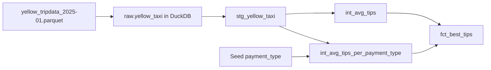
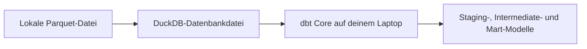

# Optional: Kostenlose Analysen mit DuckDB

Dieser Leitfaden schließt an [01-dbt-intro](./01-dbt-intro.md) und [02-dockerize-dbt](./02-dockerize-dbt.md) an. Du führst dasselbe Projekt `dbt_intro` aus, diesmal mit **DuckDB**.

Sieh dieses Kapitel als **alternative Laufzeitumgebung auf Basis von DuckDB**, nicht als Ersatzprojekt. Du behältst dasselbe dbt-Projekt und dieselben Modelle aus 01. Die wichtigste Änderung: dbt verbindet sich mit DuckDB statt mit Postgres.

Dieses Kapitel ist **optional**. Wenn du dbt einfach an einer echten Datenbank lernen und dann in Docker ausführen willst, reichen die Kapitel 01 und 02 schon aus.

Kapitel 03 bringt dir etwas anderes:

- es zeigt, dass dasselbe dbt-Projekt mit nur kleinen Änderungen zwischen Adaptern wechseln kann,
- es gibt dir eine Analyseoption ganz ohne Server für schnelle Experimente,
- du kannst damit eine klassische Datenbank-Laufzeitumgebung mit einer schlanken, dateibasierten Laufzeitumgebung vergleichen,
- es gibt dir eine dateibasierte Ausweichlösung, wenn du Postgres nicht laufen lassen willst.

DuckDB passt hier gut, weil es:

- kostenlos ist,
- direkt auf deinem Laptop läuft,
- Parquet-Daten schnell lesen kann,
- das Setup klein genug für ein Einsteiger-Tutorial hält.

## Kostenlose Optionen auf einen Blick

Zum Zeitpunkt des Schreibens sind das die wichtigsten kostenlosen Optionen, wenn du den Stack einfach halten willst:

| Option | Kosten | Warum du sie wählen könntest | Warum sie hier nicht der Standard ist |
|---|---|---|---|
| [DuckDB + dbt Core](https://duckdb.org/) | Kostenlos | Kein Konto, kein Cloud-Setup, sehr schnelle lokale Analysen | --- |
| [Neon + dbt Core oder dbt Cloud](https://neon.com/pricing) | Kostenloser Tarif verfügbar | Extern betriebenes Postgres mit einem vertrauten Workflow für SQL-Datenbanken | Braucht trotzdem eine extern betriebene Datenbank und ein Setup für die Remote-Verbindung. |
| [dbt Cloud Developer](https://www.getdbt.com/pricing) | Kostenloser Tarif verfügbar | Verwaltete Oberfläche für dbt und geplante Jobs | Bringt trotzdem mehr Setup und mehr bewegliche Teile mit als ein Run auf Basis von DuckDB. |

Wenn dein Ziel **möglichst wenige Schritte** sind, wähl DuckDB.

## Was du baust

Starte im **selben Workspace, den du in 01 erstellt hast**. An diesem Punkt sollte er ungefähr so aussehen:

```text
dbt-intro/
  ├── data/
  ├── dbt_intro/
  ├── dbt_prod/
  └── logs/
```

Am Ende dieses Kapitels enthält der Workspace außerdem eine DuckDB-Datenbankdatei:

```text
dbt-intro/
  ├── data/
  ├── dbt_intro/
  ├── dbt_prod/
  ├── logs/
  └── ny_taxi.duckdb
```



## Bevor du anfängst

Dieses Kapitel setzt voraus, dass du 01 schon abgeschlossen hast und deshalb schon Folgendes hast:

- ein Projekt `dbt_intro`,
- die Parquet-Datei für Januar 2025 in `data/yellow_tripdata_2025-01.parquet`,
- die Staging-, Intermediate-, Mart- und Seed-Dateien aus 01,
- die installierte Umgebung aus `uv sync` im Stammverzeichnis des Repositorys.

Wenn du 01 noch nicht abgeschlossen hast, geh zuerst dorthin zurück. Dieses Kapitel nutzt absichtlich dieses Projekt wieder, statt ein eigenes zu erstellen.

`dbt-duckdb` (und `duckdb` selbst) stehen neben `dbt-postgres` schon in der `pyproject.toml` des Repositorys. Das `uv sync` beim Setup aus der [README](./README.md) des Repositorys hat also schon alles installiert, was dieses Kapitel braucht.

## 1. Lokale DuckDB-Datenbank erstellen

Erstell eine DuckDB-Datenbankdatei im Stammverzeichnis des Workspace und lade die rohe Quelltabelle hinein:

```bash
uv run python - <<'PY'
import duckdb

con = duckdb.connect("ny_taxi.duckdb")
con.execute("create schema if not exists raw")
con.execute(
    """
    create or replace table raw.yellow_taxi as
    select *
    from read_parquet('data/yellow_tripdata_2025-01.parquet')
    """
)

row_count = con.execute(
    "select count(*) from raw.yellow_taxi"
).fetchone()[0]

print(f"Loaded {row_count} rows into raw.yellow_taxi")
PY
```

Wenn du die komplette Datei für Januar 2025 lädst, sollte die Zeilenzahl **3.475.226** betragen.

So bleibt die Rohdatenquelle lokal und lässt sich leicht untersuchen.

### Erwartete Rohdatenquelle

Bevor du dbt ausführst, stell sicher, dass die Rohtabelle `raw.yellow_taxi` existiert und dieselben Quellspalten enthält wie in 01:

```text
VendorID
tpep_pickup_datetime
tpep_dropoff_datetime
passenger_count
trip_distance
RatecodeID
store_and_fwd_flag
PULocationID
DOLocationID
payment_type
fare_amount
extra
mta_tax
tip_amount
tolls_amount
improvement_surcharge
total_amount
congestion_surcharge
Airport_fee
cbd_congestion_fee
```

Dafür kannst du Folgendes ausführen:

```bash
uv run python - <<'PY'
import duckdb

con = duckdb.connect("ny_taxi.duckdb")
con.execute("""
SELECT 1
FROM information_schema.tables
WHERE table_schema = 'raw'
  AND table_name = 'yellow_taxi'
""").fetchone()[0]

columns = con.execute("""
SELECT column_name
FROM information_schema.columns
WHERE table_schema = 'raw'
  AND table_name = 'yellow_taxi'
ORDER BY ordinal_position
""").fetchall()

print("raw.yellow_taxi exists and has the following columns:")
for col in columns:
    print(col[0])
PY
```

## 2. DuckDB-Target zu `profiles.yml` hinzufügen

Öffne `~/.dbt/profiles.yml` und erweitere das bestehende Profil `dbt_intro` aus 01.

Wenn deine Datei gerade die Outputs `dev` und `prod` für Postgres enthält, behalte sie. Füg einen neuen Output `duckdb` hinzu und mach ihn zum aktiven Target:

```yaml
dbt_intro:
  outputs:

    dev:
      dbname: ny_taxi
      host: localhost
      pass: postgres
      port: 5432
      schema: dbt_dev
      threads: 4
      type: postgres
      user: postgres

    prod:
      dbname: ny_taxi
      host: localhost
      pass: postgres
      port: 5432
      schema: dbt_prod
      threads: 4
      type: postgres
      user: postgres

    duckdb:
      type: duckdb
      path: ../ny_taxi.duckdb
      schema: dbt_duckdb
      threads: 4

  target: duckdb
```

Wenn du lieber Postgres als Standard-Target behalten willst, lass `target: dev` stehen und häng an jeden dbt-Befehl in diesem Kapitel `--target duckdb` an.

### Warum `path: ../ny_taxi.duckdb`?

In den nächsten Schritten führst du dbt im Projektverzeichnis `dbt_intro/` aus. Von diesem Verzeichnis aus zeigt

```text
../ny_taxi.duckdb
```

zurück auf das Stammverzeichnis des Workspace, in dem die DuckDB-Datei liegt.

Mit diesem Target baut dbt in DuckDB-Schemas wie diese:

- `dbt_duckdb`
- `dbt_duckdb_stg`
- `dbt_duckdb_int`
- `dbt_duckdb_driver`

Das entspricht dem Muster `dbt_dev_*` und `dbt_prod_*`, das du schon aus 01 und 02 kennst.

## 3. Quelldefinition für Postgres und DuckDB nutzbar machen

In 01 hat `models/staging/src_yellow_taxi.yml` auf Folgendes gezeigt:

```text
public.yellow_taxi
```

Das war für Postgres richtig, aber die DuckDB-Version dieses Tutorials lädt die Rohtabelle in:

```text
raw.yellow_taxi
```

Pass `dbt_intro/models/staging/src_yellow_taxi.yml` so an, dass es mit beiden Adaptern funktioniert:

```yaml
version: 2

sources:
  - name: src_yellow_taxi
    schema: "{{ 'raw' if target.type == 'duckdb' else 'public' }}"
    tables:
      - name: yellow_taxi
```

Das ist die einzige Änderung auf Projektebene, mit der dasselbe dbt-Projekt in beiden Laufzeitumgebungen funktioniert:

- `public.yellow_taxi` in Postgres
- `raw.yellow_taxi` in DuckDB

Das SQL-Modell `stg_yellow_taxi.sql` aus 01 kann so bleiben. DuckDB versteht die Quellspalten mit gemischter Groß- und Kleinschreibung in Anführungszeichen problemlos:

```sql
{{ config(materialized='table', schema='stg') }}

select
    "VendorID" as vendor_id,
    tpep_pickup_datetime as pickup_datetime,
    tpep_dropoff_datetime as dropoff_datetime,
    passenger_count,
    trip_distance,
    "RatecodeID" as rate_code_id,
    store_and_fwd_flag,
    "PULocationID" as pickup_location_id,
    "DOLocationID" as dropoff_location_id,
    payment_type,
    fare_amount,
    extra,
    mta_tax,
    tip_amount,
    tolls_amount,
    improvement_surcharge,
    total_amount,
    congestion_surcharge,
    "Airport_fee" as airport_fee,
    cbd_congestion_fee
from {{ source('src_yellow_taxi', 'yellow_taxi') }}
```

## 4. Projekt in DuckDB ausführen

Wechsle ins Verzeichnis des dbt-Projekts:

```bash
cd dbt_intro
```

### Verbindung validieren

```bash
uv run dbt debug
```

Erwartetes Ergebnis:

- dbt findet `~/.dbt/profiles.yml`,
- der aktive Adapter ist `duckdb`,
- die DuckDB-Verbindung ist erfolgreich,
- der Befehl endet mit `All checks passed!`.

### Seed laden

```bash
uv run dbt seed
```

Erwartetes Ergebnis:

- dbt lädt `payment_type.csv`,
- der Seed landet im DuckDB-Zielschema, mit dem Profil oben wird er also zu `dbt_duckdb.payment_type`.

### Modelle bauen

```bash
uv run dbt run
```

Erwartetes Ergebnis:

- `dbt_duckdb_stg.stg_yellow_taxi`
- `dbt_duckdb_int.int_avg_tips`
- `dbt_duckdb_int.int_avg_tips_per_payment_type`
- `dbt_duckdb_driver.fct_best_tips`

### Tests ausführen

```bash
uv run dbt test
```

Die realistischen Tests aus 01 funktionieren auch hier. Du solltest dieselben `PASS`-Ergebnisse sehen, jetzt aber gegen DuckDB statt gegen Postgres ausgeführt.

### Dokumentation generieren

```bash
uv run dbt docs generate
```

Das schreibt die Artefakte der Doku genau wie vorher ins lokale Verzeichnis `target/`.

## Warum diese Version einfacher ist



Die beweglichen Teile in diesem Kapitel sind:

- der Adapter `dbt-duckdb`,
- eine DuckDB-Datenbankdatei,
- eine kleine Änderung an der Konfiguration der Quelle in `src_yellow_taxi.yml`.

Deshalb ist DuckDB der beste Standard für einen kostenlosen Einsteigerpfad.

## Checkliste zur Überprüfung

Nutz diese Checkliste am Ende des Kapitels:

1. `uv run python - <<'PY' ... PY` lädt `3475226` Zeilen in `raw.yellow_taxi`.
2. `uv run dbt debug` endet mit `All checks passed!`.
3. `uv run dbt seed` lädt `dbt_duckdb.payment_type`.
4. `uv run dbt run` baut die Staging-, Intermediate- und Mart-Modelle in DuckDB.
5. `uv run dbt test` endet damit, dass alle Tests bestehen.
6. `uv run dbt docs generate` schreibt die Artefakte der Doku nach `target/`.

Wenn alle sechs Prüfungen erfolgreich sind, funktioniert dein dbt-Projekt in DuckDB von Anfang bis Ende.
